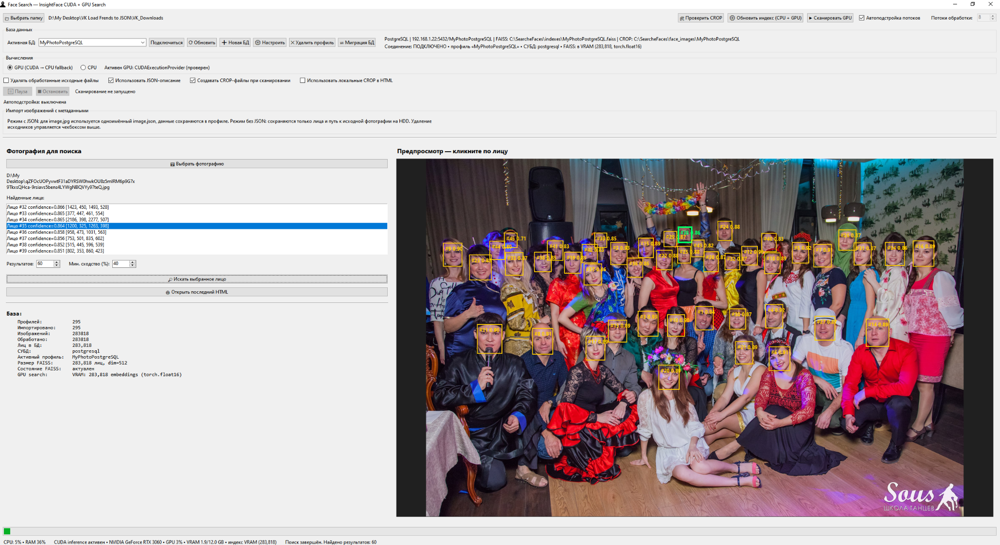
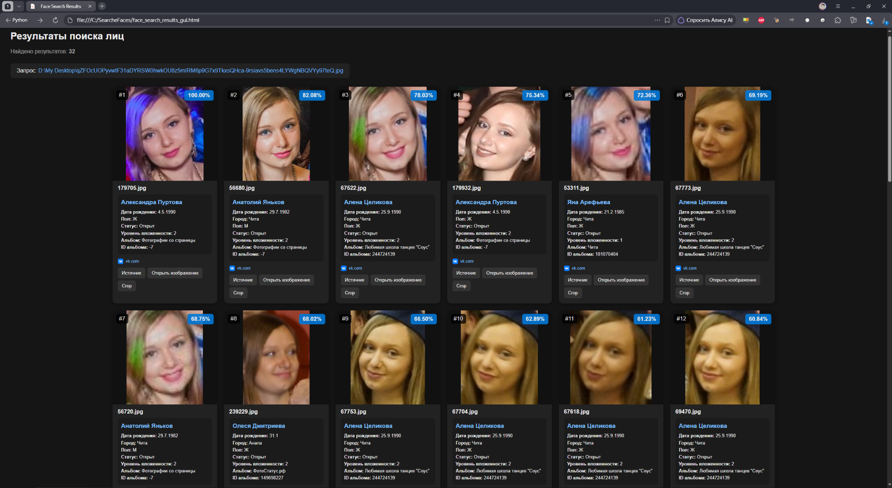
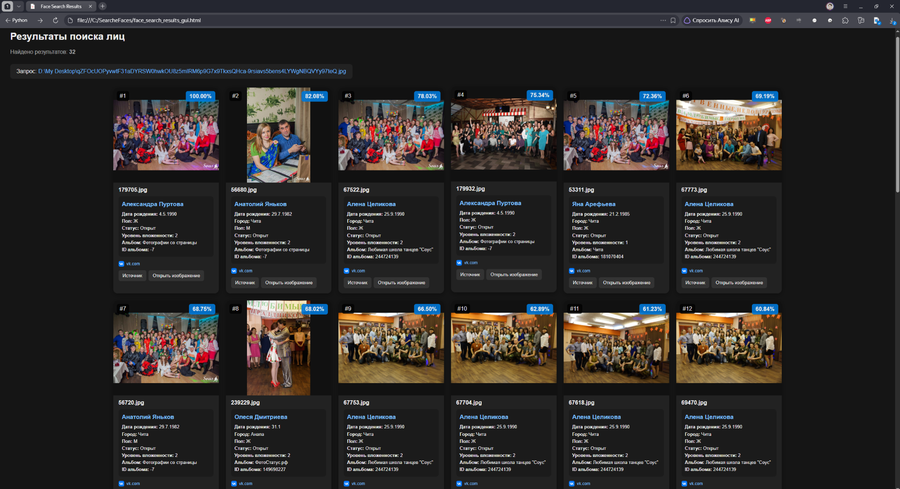
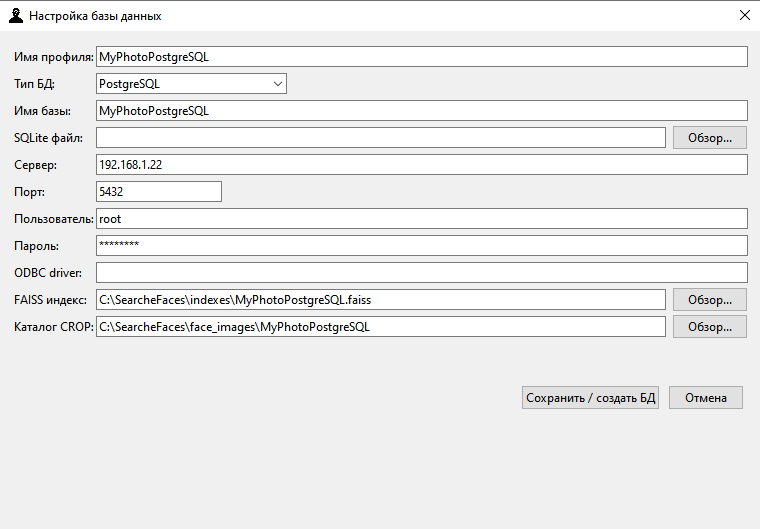
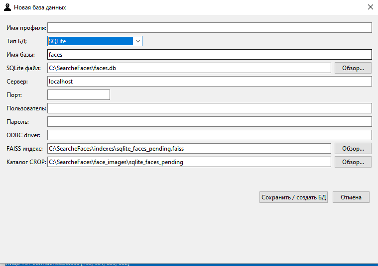
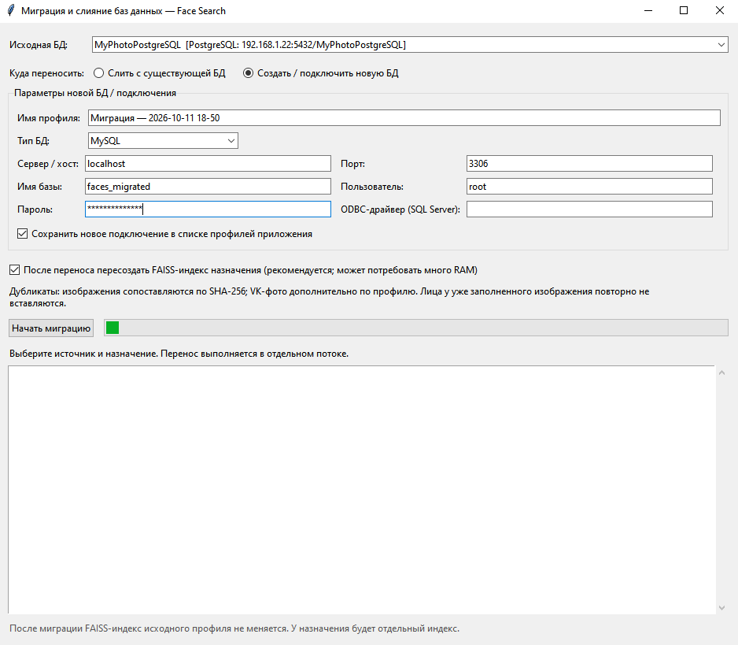

# Face Search — поиск похожих лиц на фотографиях

**Face Search** — настольное приложение для Windows с графическим интерфейсом, которое обнаруживает лица на фотографиях, создаёт для них векторные представления и ищет похожие лица в собственной коллекции. Для обработки изображений используется **InsightFace**, а для быстрого поиска ближайших векторов — **FAISS**. В зависимости от окружения вычисления можно выполнять на CPU или совместимом NVIDIA GPU.

Программа поддерживает несколько профилей баз данных, импорт описаний из JSON, экспорт результатов в HTML-галерею и перенос/слияние данных между базами разных типов.

> **Важно:** процент совпадения — это оценка сходства векторных представлений, а не вероятность того, что на фотографиях точно один и тот же человек. Результаты требуют проверки человеком и не должны использоваться как единственное основание для важных решений.

## Содержание

- [Возможности](#возможности)
- [Скриншоты](#скриншоты)
- [Как это работает](#как-это-работает)
- [Установка и запуск](#установка-и-запуск)
- [Первый запуск](#первый-запуск)
- [Импорт фотографий и JSON](#импорт-фотографий-и-json)
- [Поиск лиц](#поиск-лиц)
- [HTML-отчёт](#html-отчёт)
- [Базы данных и профили](#базы-данных-и-профили)
- [Миграция и слияние баз](#миграция-и-слияние-баз)
- [Командная строка](#командная-строка)
- [Структура проекта](#структура-проекта)
- [Настройки и хранение данных](#настройки-и-хранение-данных)
- [Устранение неполадок](#устранение-неполадок)
- [Конфиденциальность и ответственное использование](#конфиденциальность-и-ответственное-использование)
- [Лицензия](#лицензия)

## Возможности

### Поиск по лицу

- Выбор фотографии для поиска и предварительный просмотр обнаруженных на ней лиц.
- Выбор конкретного лица на групповом снимке.
- Поиск похожих лиц в базе с ранжированием результатов по оценке сходства.
- Настройка количества результатов и минимального порога сходства.
- Вывод прямоугольников обнаружения и оценок детектора в интерфейсе.

### Обработка коллекций фотографий

- Сканирование локальной папки с фотографиями и поиск лиц на каждом изображении.
- Поддержка форматов `.jpg`, `.jpeg`, `.png`, `.webp`, `.bmp`, `.tif` и `.tiff`.
- Параллельная обработка с настройкой количества рабочих потоков.
- Опциональная автоматическая подстройка числа потоков по данным мониторинга ресурсов.
- Импорт описаний из одноимённых JSON-файлов или обработка изображений без метаданных.
- Возможность создавать CROP-файлы лиц при сканировании либо отложить их создание.
- Проверка и восстановление отсутствующих CROP-файлов из локального оригинала или доступного URL.
- Проверка дубликатов и очистка записей, связанных с отсутствующими изображениями.

### Поиск и ускорение

- Модель распознавания InsightFace `buffalo_l`.
- Векторный индекс FAISS для поиска похожих лиц.
- CPU-режим и GPU-режим; доступность CUDA проверяется при запуске.
- GPU-поиск с учётом доступной видеопамяти и возможностью потоковой работы с индексом.
- Пакетное чтение результатов из БД с сохранением порядка ранжирования FAISS.
- Отображение сведений о подключении, количестве записей и состоянии индекса.

### HTML-галерея результатов

- Формирование отдельного HTML-отчёта, который можно открыть в браузере.
- Карточки результатов с оценкой сходства и доступными метаданными.
- Переключение между показом локальных CROP-изображений и доступных оригиналов.
- Ссылки на страницу источника и на оригинальное изображение, если для записи задан `url_image`.
- Отображение домена и favicon для записей с источником.
- Кнопка открытия локального изображения для фотографий без JSON-описания.

### Работа с несколькими базами

- Профили для **SQLite**, **PostgreSQL**, **MySQL** и **Microsoft SQL Server**.
- Отдельные пути индекса FAISS и каталога CROP для каждого профиля.
- Создание профиля и настройка параметров подключения из интерфейса.
- Подключение к выбранному профилю и обновление сведений о базе.
- Отдельное окно миграции для копирования данных в новую БД или слияния с существующей.
- При миграции выполняется сопоставление дубликатов изображений по SHA-256; повторно найденные лица уже перенесённых изображений пропускаются.
- Возможность пересоздать FAISS-индекс целевой базы после миграции.

## Скриншоты

### Главное окно

В главном окне выбирается фотография для поиска, просматриваются обнаруженные лица, задаются параметры поиска, выбирается CPU/GPU-режим и управляется сканирование коллекции. В нижней части отображается сводная информация о базе и индексе.



### HTML-результаты: с локальными CROP-изображениями и без них

В обоих вариантах показана HTML-галерея. При использовании CROP в карточках отображаются локально подготовленные изображения лиц; при отключении этой опции используются доступные оригиналы или резервные источники изображения.

<table>
  <tr>
    <td align="center"><strong>С локальными CROP</strong></td>
    <td align="center"><strong>Без локальных CROP</strong></td>
  </tr>
  <tr>
    <td width="50%"></td>
    <td width="50%"></td>
  </tr>
</table>

### Настройка профиля базы данных

Профиль хранит тип БД и параметры подключения, а также пути к индексу FAISS и каталогу CROP.



### Создание нового профиля



### Миграция и слияние баз данных

В отдельном окне задаётся исходная база, выбирается существующая или новая целевая база и указывается, нужно ли пересоздать FAISS-индекс назначения после переноса.



## Как это работает

1. **Выбор фотографии.** Приложение загружает снимок и обнаруживает лица.
2. **Получение вектора лица.** Для каждого обнаруженного лица рассчитывается embedding — числовое представление лица.
3. **Индексирование.** Векторы и связанные с ними данные сохраняются в базе, а индекс FAISS обеспечивает поиск ближайших векторов.
4. **Поиск.** Для выбранного лица вычисляется вектор, выполняется поиск по индексу, после чего результаты связываются с записями БД.
5. **Просмотр.** Пользователь проверяет ранжированный список результатов в приложении или открывает HTML-галерею.

Поиск сходства не заменяет визуальную проверку: качество результата зависит от качества фотографий, размера лица на кадре, ракурса, освещения и других факторов.

## Установка и запуск

### Требования

- Windows x64 — для этого окружения в проекте подготовлены установочный и стартовые `.bat`-файлы.
- Доступ к интернету на этапе первичной установки зависимостей и при первой загрузке необходимых моделей.
- Доступное место на диске под Python-окружение, модели, фотографии/CROP, базу данных и FAISS-индекс.
- NVIDIA GPU с совместимыми драйверами — **необязателен**, но может ускорять обработку и поиск. Без совместимого GPU программа устанавливает CPU-вариант.
- Для подключения к серверным БД должны быть доступны сервер, учётные данные и соответствующий сетевой доступ. Для Microsoft SQL Server дополнительно требуется установленный ODBC-драйвер.

### Автоматическая установка

1. Скачайте репозиторий или распакуйте архив проекта.
2. Откройте папку `FaceSearch`.
3. Запустите `setup.bat` и дождитесь окончания установки и проверок.
4. Запустите `start_gui.bat`.

`setup.bat` подготавливает виртуальное окружение `.venv`, устанавливает Python и зависимости через `uv`, определяет доступность NVIDIA GPU и выбирает подходящие варианты PyTorch и ONNX Runtime. Затем скрипт проверяет импорт основных библиотек и готовность InsightFace в выбранном режиме.

Для запуска с выводом сообщений в консоль используйте `start_gui_console.bat`.

### Ручной запуск после установки

```bat
.venv\Scripts\python.exe face_search_gui.py
```

Окно миграции можно открыть из главного интерфейса кнопкой **«Миграция БД»**. Также его можно запустить отдельно:

```bat
.venv\Scripts\python.exe utilities\database_migration.py
```

## Первый запуск

1. Дождитесь, пока приложение проверит среду и подключится к выбранной базе данных.
2. В разделе баз данных выберите существующий профиль или создайте новый.
3. Для начала работы с локальной коллекцией нажмите выбор папки и укажите каталог фотографий.
4. При необходимости включите **«Использовать JSON-описание»**.
5. Определитесь с режимом **«Создавать CROP-файлы при сканировании»**. Если создание отложено, исходные фотографии потребуются для последующего восстановления CROP.
6. Запустите сканирование и дождитесь его завершения.
7. Выберите фотографию для поиска, затем нужное лицо в списке обнаруженных лиц.
8. Настройте количество результатов и минимальный порог сходства и запустите поиск.
9. Откройте HTML-отчёт, чтобы просмотреть результаты в браузере.

**Совет:** перед массовым сканированием или миграцией проверьте настройки на небольшой тестовой папке и убедитесь, что у вас есть резервная копия базы данных и исходных файлов.

## Импорт фотографий и JSON

Приложение может обрабатывать фотографии как самостоятельно, так и вместе с одноимённым JSON-файлом с описанием.

Пример структуры каталога:

```text
photos/
├── photo_001.jpg
├── photo_001.json
├── photo_002.png
├── photo_002.json
└── family.jpg
```

Для `family.jpg` JSON не обязателен. Если описание нужно, имя JSON-файла должно совпадать с именем фотографии, а расширение — быть `.json`.

### Формат JSON

Структура на верхнем уровне строгая: разрешены ровно `url_source`, `name`, `url_image` и объект `info`. Дополнительные поля источника размещайте внутри `info`. Например:

```json
{
  "url_source": "https://example.com/profile/123",
  "name": "Отображаемое имя",
  "url_image": "https://example.com/images/photo_001.jpg",
  "info": {
    "Город": "Пример города",
    "Страна": "Пример страны",
    "Дата рождения": "01.01.1990",
    "Статус": "Пример статуса",
    "И так далее": "Любая информация"
  }
}
```

Назначение полей:

- `url_source` — ссылка на страницу-источник или профиль.
- `name` — отображаемое имя записи.
- `url_image` — прямая ссылка на оригинальный файл изображения; используется, в частности, для кнопки **«Открыть изображение»** в HTML-отчёте.
- `info` — произвольный объект с дополнительными полями, которые показываются в карточке результатов.

Пример выше демонстрирует структуру, а не реальные данные. Значения полей `info` зависят от источника.

Если JSON отсутствует или импорт метаданных отключён, фотография всё равно может быть просканирована как локальное изображение. Для таких записей HTML-отчёт использует локальный путь/файл и не требует `url_source`.

Для локальных изображений **без одноимённого JSON** приложение извлекает доступные метаданные файла и хранит их в `images.metadata_json` в той же строгой оболочке из четырёх полей: `url_source`, `name`, `url_image`, `info`. Факты о файле и EXIF находятся внутри `info`. При наличии JSON-файла EXIF не читается и в `images.metadata_json` не записывается: исходный JSON профиля хранится в `profiles.raw_json`. При инициализации БД прежние плоские EXIF-объекты преобразуются в строгую оболочку, а ошибочные EXIF-данные у записей с JSON удаляются.

## Поиск лиц

На главной форме доступны параметры, влияющие на результаты:

- **Количество результатов** — ограничивает размер выдачи.
- **Мин. сходство (%)** — отбрасывает результаты ниже заданного порога.
- **CPU / GPU** — выбирает вычислительный режим там, где он доступен.
- **Потоки обработки** — задаёт параллелизм задач сканирования.
- **Автоподстройка потоков** — разрешает приложению автоматически регулировать число рабочих потоков с учётом загрузки системы.

Для поиска на групповом снимке выберите нужное лицо в списке найденных лиц, а не обязательно первое обнаружение.

## HTML-отчёт

После поиска откройте HTML-отчёт из интерфейса. Файл предназначен для просмотра в браузере и содержит карточки с ранжированными результатами.

Опция **«Использовать локальные CROP в HTML»** влияет на отображение карточек:

- **Включена:** приложение использует локальные CROP-файлы и подготавливает их рядом с HTML-отчётом в каталоге `face_crops`.
- **Выключена:** локальные CROP не используются для карточек; приложение обращается к доступному оригиналу/URL, если он сохранён.

Для записей с JSON-описанием ссылка **«Открыть изображение»** строится по `images.url_image`, то есть по URL оригинального файла, а не по адресу страницы `url_source`. Для локальных изображений без JSON остаётся открытие локального исходника.

Флажок **«Обновлять CROP и метаданные»** включает повторную обработку существующих записей. Для локальных файлов без JSON метаданные сохраняются в строгом формате; при обычном повторном сканировании существующие лица не распознаются заново. Для файлов с JSON EXIF не читается и не дописывается. Обновление схемы и преобразование ранее сохранённых метаданных выполняются автоматически для SQLite, PostgreSQL, MySQL и Microsoft SQL Server. Цветовые темы HTML-отчёта сохраняются.

Чтобы отчёт был полностью переносимым, сохраняйте созданный HTML вместе с папкой `face_crops`, если она была сформирована. Удалённые URL могут стать недоступными, а локальные ссылки зависят от расположения файлов на компьютере.

## Базы данных и профили

Поддерживаемые СУБД:

| Тип | Подключение |
|---|---|
| SQLite | Локальный файл базы данных |
| PostgreSQL | Сервер, порт, имя базы, пользователь и пароль |
| MySQL | Сервер, порт, имя базы, пользователь и пароль |
| Microsoft SQL Server | Сервер, порт, имя базы, пользователь/пароль и ODBC-драйвер |

В профиле можно задать:

- имя профиля и тип БД;
- путь к SQLite-файлу или параметры серверной базы;
- путь к FAISS-индексу;
- каталог хранения CROP-файлов.

Для разных профилей можно использовать отдельные каталоги CROP и файлы индекса — это позволяет изолировать данные разных коллекций. Важно выбирать соответствующий профиль до запуска сканирования или поиска и проверять строку состояния подключения.

Настройки подключений хранятся в `database_profiles.json`. Файл может содержать пароли для серверных баз, поэтому не добавляйте его в публичный репозиторий, если он содержит реальные учётные данные.

## Миграция и слияние баз

Окно миграции предназначено для переноса данных между поддерживаемыми СУБД, например из PostgreSQL в SQLite или из SQLite в MySQL.

Доступны два сценария:

1. **Слить с существующей БД.** Выберите существующий профиль назначения.
2. **Создать / подключить новую БД.** Укажите параметры нового целевого профиля; для серверной СУБД программа проверяет, не существует ли база назначения с таким именем.

Перед переносом проверьте исходный и целевой профили, доступность обеих баз, пути к файлам CROP и наличие свободного места. В окне можно включить перестроение FAISS-индекса назначения после переноса. Эта операция может потребовать существенного объёма оперативной памяти и времени для больших коллекций.

Миграция копирует данные профилей, изображений и найденных лиц порциями. Дубликаты изображений сопоставляются в том числе по SHA-256; при слиянии повторное добавление лиц уже существующего изображения пропускается. Итоговый журнал содержит ход операции и сводные счётчики.

## Командная строка

Основной файл поддерживает несколько команд. Запускайте их из каталога проекта и используйте Python виртуального окружения.

Запустить графический интерфейс:

```bat
.venv\Scripts\python.exe face_search_gui.py gui
```

Показать статистику активной базы:

```bat
.venv\Scripts\python.exe face_search_gui.py stats
```

Просканировать каталог:

```bat
.venv\Scripts\python.exe face_search_gui.py scan "D:\Photos"
```

Игнорировать одноимённые JSON-файлы при сканировании:

```bat
.venv\Scripts\python.exe face_search_gui.py scan "D:\Photos" --no-json
```

**Осторожно:** флаг `--delete-processed` разрешает удалять исходные файлы после успешной обработки. Используйте его только если вы точно понимаете последствия и имеете резервную копию.

Перестроить FAISS-индекс:

```bat
.venv\Scripts\python.exe face_search_gui.py build-index
```

Выполнить поиск по фотографии и получить до 24 результатов:

```bat
.venv\Scripts\python.exe face_search_gui.py search "D:\Photos\query.jpg" --top-k 24
```

CLI использует настройки/подключение базы, заданные приложением по умолчанию. Если вы работаете с несколькими профилями, сначала убедитесь, что активная база соответствует нужной коллекции.

## Веб-поиск по лицам

Отдельный многопоточный HTTP-сервер позволяет искать похожие лица через браузер, не открывая GUI:

```bat
.venv\Scripts\python.exe server_http.py
```

По умолчанию веб-интерфейс доступен только на этом компьютере: http://127.0.0.1:8765. Сервер читает выбранный в GUI профиль из `settings.xml` и `database_profiles.json`, а также использует сохранённый backend и начальные значения параметров поиска. В браузере доступны только минимальное сходство (%) и количество результатов.

Чтобы открыть интерфейс с другого компьютера в доверенной локальной сети, запустите:

```bat
.venv\Scripts\python.exe server_http.py --host 0.0.0.0 --port 8765
```

В этом режиме сервер не имеет встроенной авторизации. Не публикуйте порт в Интернет и ограничьте доступ правилами firewall. Для остановки нажмите Ctrl+C в окне сервера.

## Структура проекта

```text
FaceSearch/
├── face_search_gui.py             # Основной GUI, обработка, поиск и CLI
├── server_http.py                 # Многопоточный веб-поиск по лицам
├── utilities/                     # Вспомогательные инструменты обслуживания БД
│   ├── database_migration.py       # Окно миграции/слияния БД
│   └── database_cleanup.py         # Очистка БД и связанных записей
├── requirements.txt               # Общие Python-зависимости
├── setup.bat                      # Подготовка окружения и проверка CPU/GPU
├── start_gui.bat                  # Запуск GUI без консоли
├── start_gui_console.bat          # Запуск с выводом в консоль
├── facesearch/
│   ├── config.py                  # Общие константы и пути
│   ├── settings.py                # Чтение/запись settings.xml
│   ├── database_profiles.py       # Профили БД и пути хранения
│   ├── database/
│   │   ├── connection.py          # Подключение к разным СУБД
│   │   └── schema.py              # Создание/проверка схемы БД
│   ├── indexing/
│   │   └── result_mapping.py      # Привязка результатов FAISS к записям БД
│   ├── processing/
│   │   └── telemetry.py           # Мониторинг ресурсов и потоки
│   └── export/
│       └── html_report.py         # Генерация HTML-галереи
├── icons/                         # Иконки приложения
└── docs/screenshots/              # Скриншоты для README
```

При запуске приложения могут создаваться дополнительные файлы и каталоги:

- `.venv/` — виртуальное окружение Python;
- `settings.xml` — настройки главного окна и параметры интерфейса;
- `database_profiles.json` — список профилей БД (общий файл, используется GUI и утилитами);
- `utilities/database_cleanup_settings.xml` — индивидуальные настройки окна очистки;
- `utilities/database_migration_settings.xml` — тема, размер/положение окна и параметры формы миграции;
- при первом запуске прежние JSON-настройки утилит автоматически переносятся в XML и удаляются после успешной конвертации;
- `utilities/temp/` — временный файл сопоставления при миграции, автоматически удаляется после завершения;
- `indexes/` — индексы FAISS;
- `face_images/` или заданные в профилях каталоги — CROP-файлы;
- файл SQLite и служебные файлы БД — если используется SQLite.

## Настройки и хранение данных

Приложение сохраняет основные параметры интерфейса в `settings.xml`, в том числе выбранный профиль БД, выбранные пути, режим CPU/GPU, число потоков, состояние автоподстройки, настройки JSON и CROP, параметры поиска и геометрию окна.

В базе используются таблицы `profiles`, `images` и `faces`. В общем случае они содержат сведения об источниках/описаниях, записи изображений и данные обнаруженных лиц с embedding и координатами. В `images` для импортированных записей могут храниться `source_url` и `url_image`.

В новых записях путь CROP хранится относительно каталога CROP активного профиля. Это упрощает работу разных профилей с собственными каталогами; старые абсолютные пути поддерживаются для совместимости.

Не публикуйте базы данных, embeddings, исходные фотографии, CROP-файлы, `settings.xml`, XML-настройки в `utilities/` и `database_profiles.json`, если они содержат приватные данные или параметры подключения.

## Устранение неполадок

### Приложение не запускается после распаковки

Запустите `setup.bat` и дождитесь сообщения об успешной проверке окружения. Если установка прерывается, сохраните текст ошибки из консоли и проверьте доступ к интернету, место на диске и права на создание файлов в папке проекта.

### GPU недоступен

Приложение может работать на CPU, если CUDA недоступна. Проверьте версию драйвера NVIDIA и сообщения `setup.bat`. Для диагностики можно запустить `start_gui_console.bat` и посмотреть сообщения среды. Успешная установка пакетов сама по себе не гарантирует доступность CUDA на конкретном компьютере.

### Не удаётся подключиться к серверной БД

Проверьте адрес сервера, порт, имя базы, учётные данные и сетевые правила. Для Microsoft SQL Server убедитесь, что указан установленный ODBC-драйвер. После изменения профиля подключитесь к нему снова и проверьте состояние соединения.

### В HTML не показывается изображение

Для импортированной записи проверьте, что `url_image` содержит доступный прямой URL изображения, а не ссылку на страницу профиля. Для локального CROP проверьте путь каталога CROP в активном профиле и выполните проверку/восстановление CROP. Для локальных файлов без JSON убедитесь, что исходник существует и доступен по сохранённому пути.

### Индекс не соответствует выбранной базе

Проверьте активный профиль и указанный для него файл индекса FAISS. Для нового или перенесённого набора данных может потребоваться построить индекс заново. Не используйте один и тот же файл индекса для независимых баз.

## Конфиденциальность и ответственное использование

Фотографии лиц и векторные представления могут относиться к чувствительным персональным/биометрическим данным. Обрабатывайте только те данные, на которые у вас есть соответствующие права и законные основания. Соблюдайте требования законодательства и правила площадок, с которых получены изображения. Ограничьте доступ к базам, резервным копиям, отчётам и профилям подключений.

Face Search — инструмент поиска визуально похожих лиц, а не система подтверждения личности. Не делайте вывод о личности человека только на основании процента сходства.

## Лицензия

На момент подготовки этого README файл `LICENSE` в проекте отсутствует.
